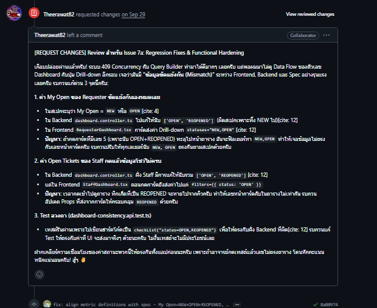
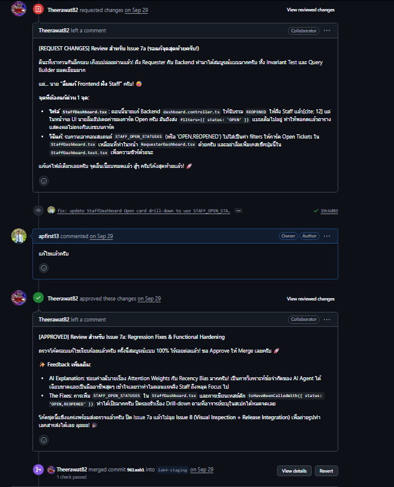
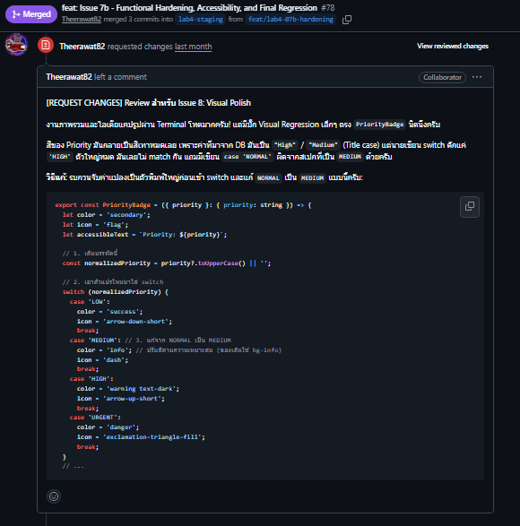
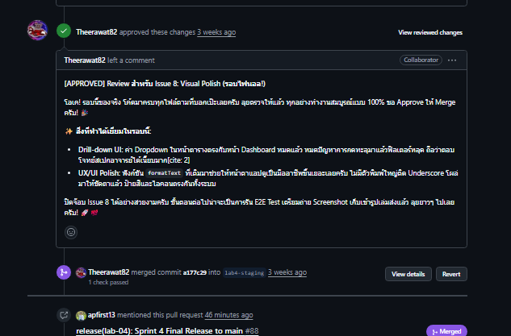

# Lab 4 Peer Review Log

เอกสารรวบรวมประวัติการทำ Peer Review และข้อเสนอแนะระหว่างการพัฒนา Lab 4 (TokTickIT)

## ข้อมูลผู้รีวิว (Reviewers)
- **Theerawat82** (Theerawat)

---

## สรุปการรีวิวที่สำคัญใน Lab 4

### 1. PR #77: Issue 7a - Staff & Requester Dashboard Drill-down Sync
- **Link:** [https://github.com/apfirst13/toktickit/pull/77](https://github.com/apfirst13/toktickit/pull/77)

- **Feedback จากผู้รีวิว (`Theerawat`):**
  1. **Requester Dashboard:** การ์ด `My Open` นับแค่ `OPEN` กับ `REOPENED` แต่ตกสถานะ `NEW` ทำให้พอกด Drill-down เข้าไปแล้วยอดตั๋วไม่ตรงกับการ์ด
  2. **Staff Dashboard:** การ์ด `Open` ใน backend นับรวม `REOPENED` แล้ว แต่หน้าเว็บ `StaffDashboard.tsx` ดันส่ง query ไปแค่ `status=OPEN` ตั๋วเปิดซ้ำเลยไม่ขึ้นในตาราง
  3. **Test Invariant:** เทสต์ `dashboard-consistency.api.test.ts` ไปเขียน hardcode ค่าให้ตรงกับ backend ที่ผิด ไม่ได้เช็คตามค่าจริงที่ UI ส่งมา
  4. **Staff UI ตกหล่น:** รอบแรกแก้แค่ฝั่ง Requester แต่ยังลืมแก้ `StaffDashboard.tsx` ฝั่ง Staff

- **การแก้ไข:** 
  - ปรับสเปกและโค้ดให้ `My Open` รวม `NEW`, `OPEN` และ `REOPENED`
  - สร้างค่าคงที่กลาง `STAFF_OPEN_STATUSES = ['OPEN', 'REOPENED']` ใน `ticket-query.util.ts` ให้ backend และ frontend เรียกใช้ร่วมกัน
  - แก้ไข `StaffDashboard.tsx` ให้ส่งค่า `status=OPEN,REOPENED` พร้อมเขียนเทสต์ดักจับ

- **หลักฐานการรีวิว:**
  - **Request Changes:**
    
  - **Approve & Merge:**
    

---

### 2. PR #78: Issue 7b - Functional Hardening & Polish
- **Link:** [https://github.com/apfirst13/toktickit/pull/78](https://github.com/apfirst13/toktickit/pull/78)

- **Feedback จากผู้รีวิว (`Theerawat`):**
  1. **PriorityBadge สีเทา:** สีของ Badge กลายเป็นสีเทาทั้งหมด เพราะค่าใน DB เป็น `High` / `Medium` แต่โค้ดไปดักเฉพาะตัวพิมพ์ใหญ่ `HIGH` และมี case `NORMAL` ที่ผิดสเปกอาจารย์ (ต้องเป็น `MEDIUM`)
  2. **Dropdown ค่าว่าง:** เมื่อกดลิงก์มาจาก Dashboard ด้วยค่าหลายสถานะ (`OPEN,REOPENED`) ช่อง Dropdown หน้าตารางแสดงค่าว่างเพราะไม่มี `<option>` รองรับ
  3. **Raw Enum:** ข้อความบางสถานะยังติด Underscore เช่น `IN_PROGRESS`

- **การแก้ไข:**
  - ใช้ `.toUpperCase()` แปลงค่าความสำคัญก่อนเข้า switch-case และแก้ `NORMAL` เป็น `MEDIUM`
  - เพิ่มตัวเลือก `<option value="OPEN,REOPENED">Open & Reopened</option>` ใน Dropdown
  - สร้างฟังก์ชัน `formatText` ใน `Badges.tsx` เพื่อตัดขีดล่างและแปลงคำเป็น Title Case

- **หลักฐานการรีวิว:**
  - **Request Changes:**
    
  - **Approve & Merge:**
    

---

### 3. PR #82: Fix - Form Double-click Guard
- **Link:** [https://github.com/apfirst13/toktickit/pull/82](https://github.com/apfirst13/toktickit/pull/82)

- **Feedback จากผู้รีวิว (`Theerawat`):**
  - ฟอร์ม Actions Taken มีการประกาศ `isSubmittingRef` ไว้แล้ว แต่ในฟังก์ชัน `handleSubmit` ไม่ได้เอามาเช็ค ทำให้การกดย้ำๆ ยังเสี่ยงเกิดข้อมูลซ้ำซ้อนในฐานข้อมูลได้

- **การแก้ไข:**
  - ดัก `if (isSubmittingRef.current) return;` ที่หัวฟังก์ชัน และคืนค่า `false` ในบล็อก `finally`
  - สั่ง Disable ปุ่ม Submit ระหว่างส่งข้อมูล
  - เพิ่ม E2E Test ทดสอบการคลิกปุ่มรัวๆ 4 ครั้งติดกัน

- **สถานะ:** ผู้รีวิวตรวจสอบและ Approve เรียบร้อย

---

### 4. PR อื่นๆ ใน Lab 4 (Core Features & Releases)
- **PR #71:** Foundation Spec, Tests DD, Prisma Migration `add_actions_taken` → [Link](https://github.com/apfirst13/toktickit/pull/71)
- **PR #72:** Actions Taken Backend REST API & Validation → [Link](https://github.com/apfirst13/toktickit/pull/72)
- **PR #73:** Actions Taken Frontend UI & Timezone Formatting → [Link](https://github.com/apfirst13/toktickit/pull/73)
- **PR #74:** Ticket Workflow & Resolution Gate (BR-01) → [Link](https://github.com/apfirst13/toktickit/pull/74)
- **PR #75:** Requester Dashboard Metrics & Drill-down → [Link](https://github.com/apfirst13/toktickit/pull/75)
- **PR #76:** IT Staff Dashboard Operational Queue → [Link](https://github.com/apfirst13/toktickit/pull/76)
- **PR #79:** Release Integration & Responsive Verification → [Link](https://github.com/apfirst13/toktickit/pull/79)

- **สถานะ:** ผ่านการตรวจสอบตามเกณฑ์ Acceptance Criteria และ Approve ครบทั้งหมด

---

**บทสรุป:** การทำ Peer Review ใน Lab 4 ช่วยให้ตรวจพบบั๊กที่ Automated Test มองไม่เห็น เช่น ตัวเลขขัดแย้งกันระหว่างหน้า Dashboard กับตารางคิวงาน, การแสดงผล Dropdown ค่าว่าง และการกดปุ่ม Submit ซ้ำซ้อน การมีเพื่อนร่วมทีมช่วยตรวจโค้ดทำให้ระบบมีความสอดคล้อง (Data Consistency) และทำงานได้สมบูรณ์ตามสเปก